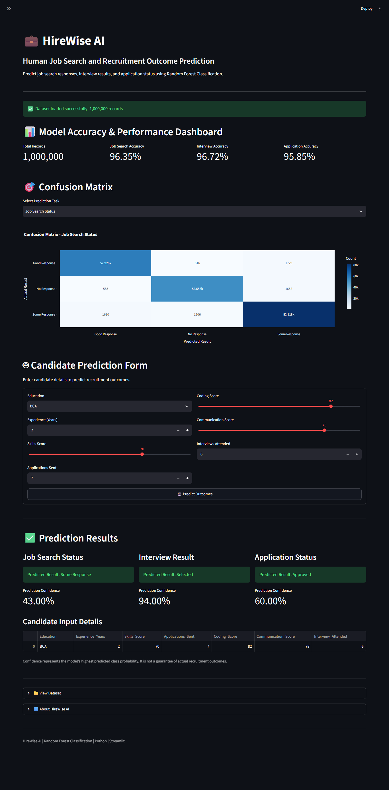

# 💼 HireWise AI – Human Job Search and Recruitment Outcome Prediction

<p align="center">
  
  
  
  
</p>

## 🚀 Live Demo

**Experience HireWise AI Online:**

[🌐 Launch HireWise AI Application](https://hirewise-ai-3gbjctudzhd4r9w79ed2fh.streamlit.app/explore)

---
## 📸 Project Screenshot

<p align="center">
 
</p>
---

## 📌 Project Overview

**HireWise AI** is an AI-powered Human Job Search and Recruitment Outcome Prediction System developed using Python and Machine Learning.

The application uses the **Random Forest Classification** algorithm to analyze candidate information and predict recruitment-related outcomes.

It provides an interactive dashboard for analyzing job search responses, interview results, and application statuses.

The system helps users understand recruitment patterns through data visualization, model performance analysis, and candidate-based predictions.

---

## 🎯 Problem Statement

The recruitment process involves analyzing large amounts of candidate information, including education, experience, skills, coding ability, communication skills, and interview performance.

Manually analyzing this information can be time-consuming and difficult.

HireWise AI addresses this challenge by using machine learning to analyze candidate data and predict possible recruitment outcomes.

---

## 💡 Project Objectives

* Analyze candidate recruitment data.
* Perform data preprocessing and cleaning.
* Apply Random Forest Classification.
* Predict job search responses.
* Predict interview results.
* Predict application status.
* Visualize model performance.
* Provide interactive candidate predictions.

---

## 🛠️ Technologies Used

| Technology                | Purpose                        |
| ------------------------- | ------------------------------ |
| Python                    | Core Programming Language      |
| Streamlit                 | Web Application Framework      |
| Pandas                    | Data Processing                |
| NumPy                     | Numerical Operations           |
| Scikit-learn              | Machine Learning               |
| Random Forest             | Classification Algorithm       |
| Plotly                    | Interactive Data Visualization |
| VS Code                   | Development Environment        |
| Git & GitHub              | Version Control                |
| Streamlit Community Cloud | Deployment                     |

---

## 🤖 Machine Learning Algorithm

### Random Forest Classification

Random Forest is a supervised machine learning algorithm that combines multiple decision trees to improve prediction performance.

**Working Process:**

1. Load the recruitment dataset.
2. Clean and preprocess the data.
3. Separate input features and target variables.
4. Split the dataset into training and testing data.
5. Train the Random Forest Classification model.
6. Generate predictions.
7. Evaluate model performance.
8. Display prediction results.

### Why Random Forest?

* Handles classification problems.
* Combines multiple decision trees.
* Can capture complex data patterns.
* Supports multiple input features.
* Provides feature importance information.

---

## ⚙️ Backend Process

The backend follows these stages:

**Stage 1 – Data Collection**

* Load the recruitment dataset.
* Read candidate information.

**Stage 2 – Data Cleaning**

* Handle missing values.
* Process numerical features.
* Encode categorical features.
* Prepare data for machine learning.

**Stage 3 – Model Training**

* Split training and testing datasets.
* Train Random Forest Classifier.
* Build prediction models.

**Stage 4 – Model Evaluation**

* Calculate accuracy.
* Generate confusion matrices.
* Analyze classification performance.

**Stage 5 – User Input**

* Enter candidate details.
* Submit information through the prediction form.

**Stage 6 – Prediction**

* Process candidate input.
* Apply trained models.
* Predict recruitment outcomes.

**Stage 7 – Result Visualization**

* Display prediction results.
* Show prediction confidence.
* Present candidate input details.

---

## ✨ Key Features

### 1. Model Accuracy & Performance Dashboard

* Total dataset records.
* Job Search Accuracy.
* Interview Accuracy.
* Application Accuracy.

### 2. Confusion Matrix

* Job Search Status.
* Interview Result.
* Application Status.
* Actual vs Predicted Results.

### 3. Candidate Prediction Form

Users can enter:

* Education
* Experience (Years)
* Skills Score
* Coding Score
* Communication Score
* Interviews Attended
* Applications Sent

### 4. Prediction Results

The application generates three recruitment predictions:

**Job Search Status**

* Good Response
* No Response
* Some Response

**Interview Result**

* Selected
* Rejected

**Application Status**

* Approved
* Rejected
* Other available classes from the trained dataset.

### 5. Prediction Confidence

Displays the highest predicted class probability for each prediction task.

---

## 📊 Model Performance

The dashboard displays the following accuracy values in the current application screenshot:

| Prediction Task      | Accuracy |
| -------------------- | -------: |
| Job Search Accuracy  |   96.35% |
| Interview Accuracy   |   96.72% |
| Application Accuracy |   95.85% |

*Note: These are the values displayed in the current dashboard. Actual model performance should be evaluated using an independent test dataset.*

---

## 📂 Project Structure

```text
HireWise_AI/
│
├── app.py
│
├── human_job_prediction_50000_records_converted.csv
│
├── requirements.txt
│
├── README.md
│
├── .gitignore
│
└── full.png
```

---

## 💻 Installation and Setup

### Step 1 – Clone the Repository

```bash
git clone https://github.com/saravananbass12-tech/-HireWise-AI.git
```

### Step 2 – Navigate to Project Folder

```bash
cd -HireWise-AI
```

### Step 3 – Create Virtual Environment

```bash
python -m venv .venv
```

### Step 4 – Activate Virtual Environment

Windows PowerShell:

```bash
.venv\Scripts\Activate.ps1
```

### Step 5 – Install Dependencies

```bash
pip install -r requirements.txt
```

### Step 6 – Run the Application

```bash
streamlit run app.py
```

The application will open in your browser.

---

## 📦 Requirements

The project uses:

```text
streamlit
pandas
numpy
scikit-learn
plotly
```

---

## 🌐 Deployment

**Platform:** Streamlit Community Cloud

**Live Application:**

https://hirewise-ai-3gbjctudzhd4r9w79ed2fh.streamlit.app/explore

---

## 🔮 Future Enhancements

* Resume Analysis and Screening.
* AI-Based Candidate Ranking.
* Job Recommendation System.
* Explainable AI Integration.
* Advanced Recruitment Analytics.
* Real-Time Recruitment Insights.

---

## 🎓 Benefits

* Reduces manual recruitment data analysis.
* Provides faster prediction results.
* Supports data-driven recruitment analysis.
* Visualizes recruitment performance.
* Offers an interactive prediction interface.
* Demonstrates practical machine learning applications.

---

## 👨‍💻 Developer

**SARAVANAN D**

GitHub: [saravananbass12-tech](https://github.com/saravananbass12-tech)

---

## ⭐ Support

If you find this project useful, consider giving the repository a ⭐ Star on GitHub.

---

<p align="center">
  <b>💼 HireWise AI – Making Recruitment Analysis Smarter with Machine Learning.</b>
</p>

<p align="center">
  <b>Thank You! ❤️</b>
</p>
